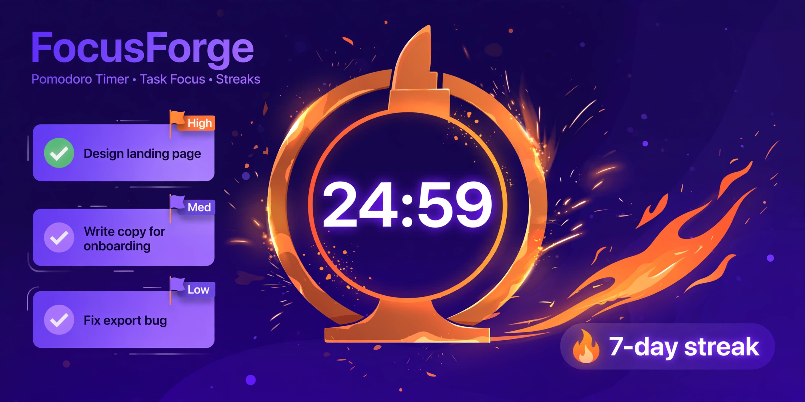

# FocusForge

[](https://www.swift.org)
[](https://developer.apple.com/ios/)
[](LICENSE)



**Forge your focus.** FocusForge pairs a classic Pomodoro timer with a priority-driven task list and daily stats — streaks included. A pure, testable state machine drives the timer; WidgetKit/Live Activity bridge structs are ready for the lock screen.

100% offline. No accounts, no API keys, no network calls.

## Features

- **Pomodoro timer** — configurable focus / short break / long break lengths and sessions-per-cycle, with a real state machine: `idle → focus → break`, plus `pause → resume → reset → skip`. Time is driven by `tick(seconds:)`, so the whole machine is deterministic and fully unit-tested.
- **Task manager** — tasks with priority (low → urgent), estimated pomodoros, per-session progress dots, and priority-first sorting.
- **Daily stats & streaks** — sessions and focus minutes per day, a 7-day activity chart, and a consecutive-day streak that doesn't read as "broken" before your first session of the day.
- **Widget / Live Activity support** — `FocusWidgetSnapshot` and `FocusLiveActivityState` are pure-data bridge structs (no WidgetKit/ActivityKit imports, so they compile and test anywhere); the Xcode app target maps them 1:1 into real `TimelineEntry` / `ActivityContent.State` types.

## Project structure

```
FocusForge/
├── Package.swift                  # Swift Package Manager — pure-logic library + tests
├── Sources/FocusForge/            # Business logic (Foundation only, no UI imports)
│   ├── PomodoroTimer.swift        # Config + pure Pomodoro state machine
│   ├── FocusTask.swift            # Task model + priority-sorted TaskList
│   ├── FocusStats.swift           # Day logs, streaks, 7-day windows, totals
│   └── WidgetSupport.swift        # Widget/Live Activity bridge structs (pure data)
├── App/                           # SwiftUI iOS app (Xcode target, not part of `swift test`)
│   ├── FocusForgeApp.swift        # @main entry point
│   ├── ContentView.swift          # TabView: Timer · Tasks · Stats
│   ├── ViewModels.swift           # @Observable view models + JSON persistence
│   ├── TimerView.swift            # Countdown ring, phase controls, timer settings
│   ├── TasksView.swift            # Task list with priorities + pomodoro dots
│   └── StatsView.swift            # Streak tile, 7-day chart, all-time totals
├── Tests/FocusForgeTests/         # XCTest suite for all business logic
└── docs/hero-banner.png
```

## Run the logic tests (no Xcode needed)

```bash
swift test
```

## Open the iOS app in Xcode

1. Open Xcode → **File → New → Project → iOS → App**, name it `FocusForge`.
2. **File → Add Package Dependencies → Add Local…** and select this folder.
3. In the app target's **Frameworks, Libraries, and Embedded Content**, add `FocusForge`.
4. Drag the `App/` folder's `.swift` files into the Xcode project.
5. Build & run on a simulator (iOS 17+).
6. **Widgets (optional):** add a Widget Extension target; build a `TimelineProvider` that emits `FocusWidgetSnapshot.make(timer:task:stats:now:)` entries, and an ActivityKit `ContentState` from `FocusLiveActivityState.make(...)`.

> The `App/` folder is intentionally outside the SwiftPM build: `swift test` compiles and tests only the pure logic, while the SwiftUI layer is written for Xcode on a Mac (Swift 5.9+, iOS 17).

## Tech stack

- Swift 5.9+, SwiftUI, `@Observable`
- Swift Package Manager (logic as a versioned library target)
- XCTest for the logic suite
- JSON file persistence in the app's documents directory

## License

MIT — see [LICENSE](LICENSE).
